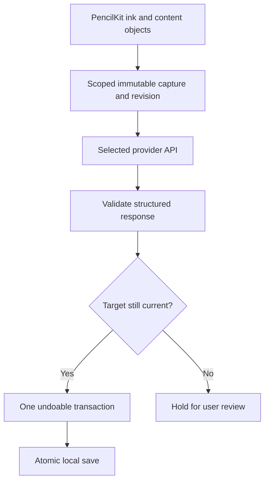
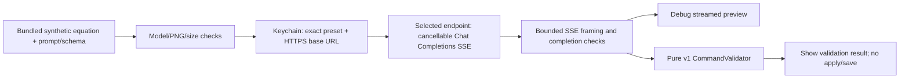
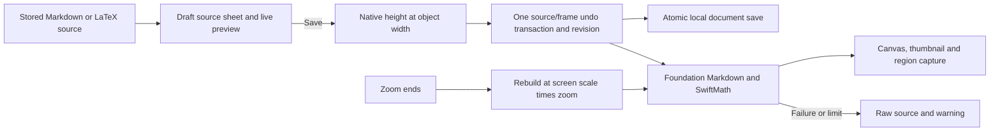
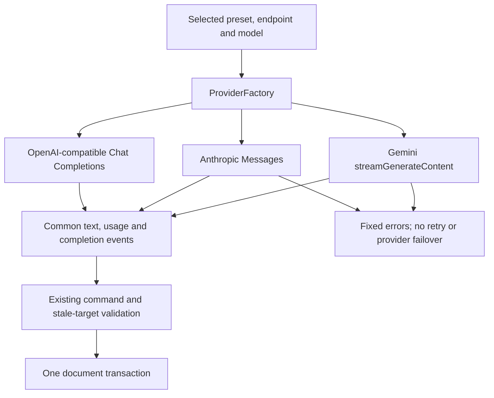

# Data Flow

Status: PLANNED conceptual view; exact schemas/implementation pending.

## Implemented provider spike (007)

This isolated Debug path does not capture or mutate a document; a real-provider run is still pending.

## Implemented rich-object editing (011)

## Selected provider dispatch (013)

