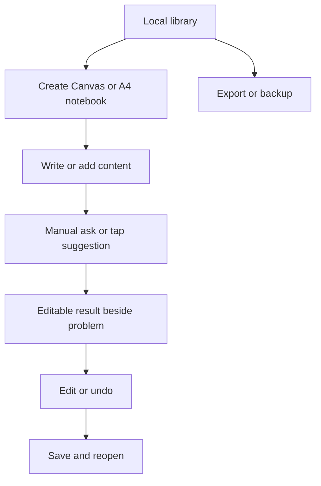
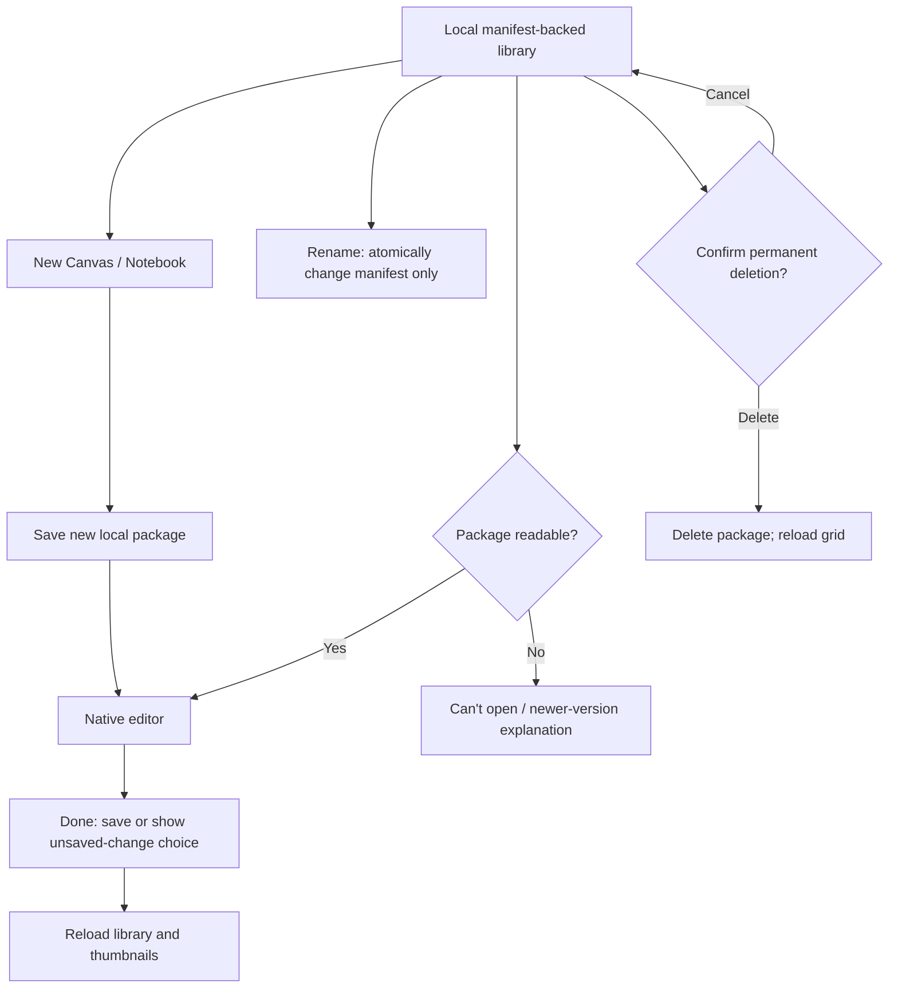

# User Flow

Status: PLANNED conceptual view; exact schemas/implementation pending.

## Implemented library path (009)

The diagram above remains broader product intent. This library path is implemented and simulator-tested; physical product acceptance is separate.

